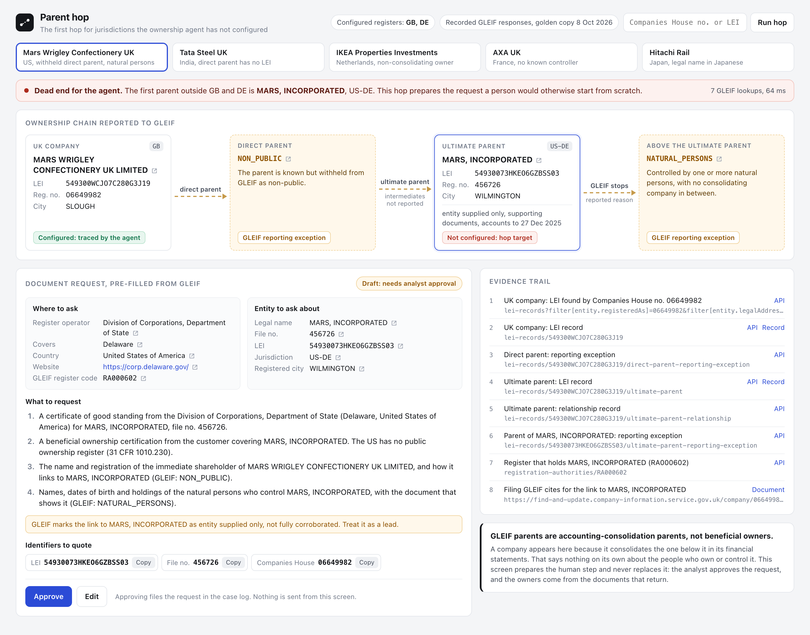

# Parent hop

**The problem, from UBO-Bench (Taktile Labs, Sep 2026).** The ownership agent was tested with every register except the UK and Germany switched off. In 12.3% of UK chains with a corporate parent, the chain reached a parent outside both, and the agent correctly logged it as a dead end for a person to trace. The write-up adds that every EU register needs its own configuration and the US has no public ownership register at all.

**What this does.** It is the first hop for any country nobody has configured yet. Give it the UK company (Companies House number or LEI). It asks GLEIF for the company's LEI, its direct and ultimate parent records, any reporting exceptions with their reasons, and the registration authority behind the parent. Then it hands the analyst a pre-filled document request: which register in which country, what to ask for, the identifiers to quote, and an evidence trail where every value links back to the GLEIF record it came from. Approve or Edit, one screen.

**What it does not do.** GLEIF parents are accounting-consolidation parents, not beneficial owners. This prepares the human step and never replaces it.



## Run it

Python 3.9+ and nothing else for the app. Tests need pytest (installed into `.venv` by `make test`).

```sh
make demo      # serves the screen on a free localhost port, recorded GLEIF data, no network
make live      # same screen, straight from api.gleif.org (no key needed)
make test      # pytest on the recorded responses, network calls fail the run
make record    # re-record the fixtures from the live API
make screenshot
```

Without make: `python3 app.py [--live] [--port 8800] [--open]`.
From the terminal: `python3 hop.py 06649982` prints the chain and the drafted request; add `--live` for any other UK company.

## The five companies

Picked from GLEIF data itself and checked live on 8 Oct 2026. All five have a parent outside GB and DE. Every chain ends in a GLEIF reporting exception, and two have one in the middle.

| Companies House | UK company | What GLEIF reports above it | Register the request goes to |
|---|---|---|---|
| 06649982 | Mars Wrigley Confectionery UK Limited | Direct parent withheld (`NON_PUBLIC`); ultimate parent Mars, Incorporated, US-DE; above it `NATURAL_PERSONS` | Delaware Division of Corporations, plus a beneficial ownership certification from the customer |
| 02280000 | Tata Steel UK Limited | Direct parent has no LEI (`NO_LEI`); ultimate parent Tata Steel Limited, IN; above it `NO_KNOWN_PERSON` | Ministry of Corporate Affairs, India |
| 03026333 | IKEA Properties Investments Limited | Ingka Holding B.V., NL; above it `NON_CONSOLIDATING` | Netherlands Chamber of Commerce, plus the Dutch UBO register |
| 02937724 | AXA UK PLC | AXA, FR; above it `NO_KNOWN_PERSON` | Sirene (INSEE), plus the French UBO register |
| 05598549 | Hitachi Rail Limited | 株式会社 日立製作所 (Hitachi, Ltd.), JP; above it `NO_KNOWN_PERSON` | Legal Affairs Bureau, Japan |

The raw GLEIF responses for all five are in `fixtures/` (38 files), named after the API path they came from.

## How it works

`hop.py` (stdlib only) does at most 8 GETs per company and follows the links inside each GLEIF record, so it never guesses a URL:

1. `lei-records?filter[entity.registeredAs]=<CH no.>&filter[entity.legalAddress.country]=GB` finds the LEI.
2. `lei-records/<LEI>` gives the record and its `direct-parent` / `ultimate-parent` links, each either a parent plus a relationship record, or a reporting exception.
3. For the highest parent it finds, it reads that parent's own `ultimate-parent-reporting-exception`: the point where GLEIF itself stops.
4. The first parent outside the configured set (`CONFIGURED = ("GB", "DE")`) is the hop target. Its `registeredAt` code goes to `registration-authorities/<RA code>`, which names the actual national register, its operator, website and the jurisdiction it covers.

Every value the screen shows is stored as `{value, src, path}`: the GLEIF URL and the JSON path it was read from. The small link icon next to each value opens that record. The tests re-read every one of those values from the recorded response and fail if any differ.

The asks are fixed rules on top of the GLEIF data: a register extract for the parent; a UBO register extract when the parent is in the EU; a beneficial ownership certification from the customer when it is in the US (the UBO-Bench write-up cites 31 CFR 1010.230); a shareholder register otherwise; and one extra ask per reporting exception (who the withheld or LEI-less direct parent is, who the natural persons are, who the non-consolidating controller is, or whether anyone holds more than 25%).

Approve appends the request to `approvals.jsonl` in the repo folder (git-ignored). Edit swaps the card for the plain draft so the analyst can rewrite it; an edited draft is marked as no longer checked against GLEIF. Nothing is ever sent.

## Tests

```
make test
23 passed
```

They cover: the chain for each of the five companies (roles, LEIs, jurisdictions, exception codes); LEI and Companies House input giving the same chain; exceptions turning into the right asks and flags; the register named on each card coming from the right registration authority record; every traced value matching its recorded GLEIF response at its JSON path; every ask using only traced fields; a parent in a configured jurisdiction producing no request; an unknown company failing with a clear message; the HTTP server end to end including Approve; and no em or en dashes in the copy.

## Limits, honestly

- **Not beneficial owners.** A GLEIF parent consolidates the child in its accounts. It says nothing about the people behind it. The output is a request, not an answer.
- **LEI coverage.** It only works when the UK company has an LEI. Plenty of small private groups have none. The obvious next step is to start from the foreign parent named in the Companies House PSC register and match it on GLEIF by name and country; not built.
- **Gaps in the middle.** When the direct parent is withheld (`NON_PUBLIC`) or has no LEI (`NO_LEI`), only the ultimate parent is known and any foreign intermediate holding company is invisible. The card asks for it, but the chain cannot show it.
- **Where to start.** It expects the last UK entity the agent traced. If you start lower in a UK chain, it uses GLEIF's ultimate parent and does not walk the UK intermediates.
- **The named register is not always the useful one.** GLEIF lists the authority the LEI issuer validated against. For AXA that is Sirene, the INSEE business directory, not the commercial court registry where filings sit (the SIREN number works there too). Delaware confirms a company exists, not who owns it. Japan's commercial registry does not list shareholders. Those are exactly the per-country rules the write-up says each register needs; this hop only gets the analyst to the right door.
- **Fixed rules.** EU vs US vs rest of world is the only country logic. Access to EU UBO registers differs by country, and the 25% threshold is hardcoded. Both would move into per-customer config.
- **Data quality.** GLEIF marks some parent links "entity supplied only"; the card flags those and lapsed LEIs, but does not second-guess them.
- **Snapshot.** Fixtures are from the GLEIF golden copy of 8 Oct 2026 and will drift; `make record` refreshes them and the tests then pin the new snapshot.
- **Plain-language reasons.** The one-line explanations of each reporting exception code are my paraphrase of GLEIF's definitions.
- **Demo scope.** No auth, no case manager integration, Approve only writes a local file.

Built by Sri Krishna Vamsi.
